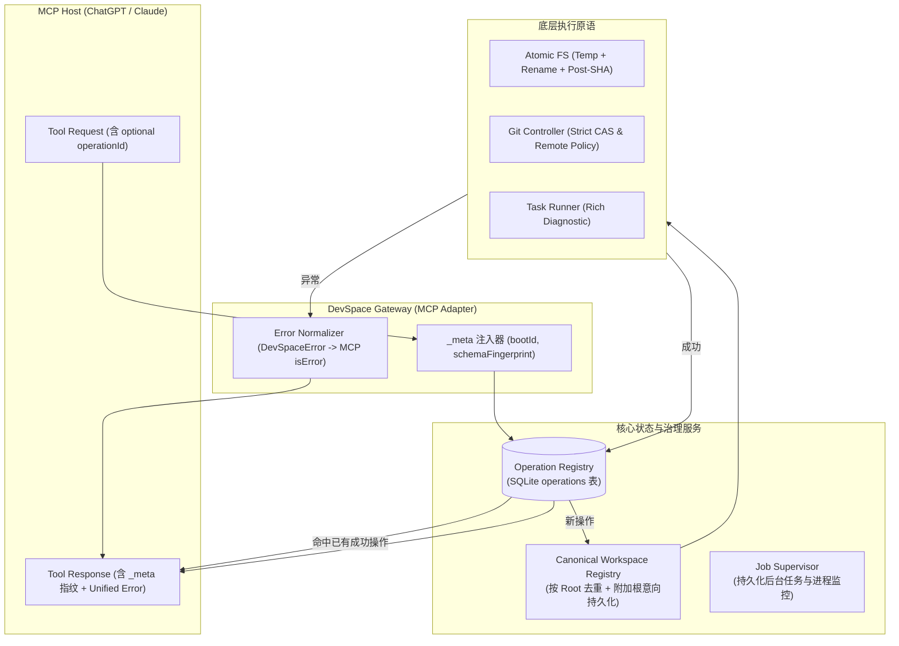

# DevSpace：ChatGPT 调用可靠性全量升级开发计划 (2026-08-29)

---

## 1. 背景与升级目标

经过对 DevSpace 仓库全量代码取证与动态故障注入测试，DevSpace 在基础协议标准、原生文件系统 API 取代 PowerShell、Python Bootstrap 隔离与 Git 前置 CAS 校验等方面已有坚实基础。

然而，在**“网络超时、意外断线、进程重启、Schema 缓存滞后与模型重复重试”**等异常链路下，系统依然缺乏闭环保障。

**本升级计划的核心目标**：
1. **零重复副作用**：通过引入 SQLite 驱动的 **Operation Registry**，让所有写、改、提交、任务派发具备幂等性与终态可查询性。
2. **稳定 Workspace 实体**：实现 **Canonical Workspace** 去重，消除同一项目重复多开；建立 `additionalRoots` 授权意向持久化与重启恢复契约。
3. **结构化错误与丰富诊断**：废除单一 `TASK_APPROVAL_FAILED` 等吞没错误的旧模式，全仓统一 **DevSpaceError** 信封（含 `layer`, `code`, `retryable`, `safeToRetry`, `recoveryHint`）。
4. **响应级指纹闭环**：在常规工具响应 `_meta` 中广播 `bootId` 与 `schemaFingerprint`，让客户端感知服务端重启与 Schema 过期。
5. **代码整洁与模块化治理**：全仓单文件行数严格限制在 900 行以内，提升可维护性与测试隔离度。

---

## 2. 升级架构总览



---

## 3. P0 阶段：核心防护与数据安全 (里程碑 M1)

### Epic P0-1: Operation Registry 幂等性与状态查询层

#### 1. 数据库 Schema 变更 (`src/db/schema.ts`)
```typescript
export const operations = sqliteTable("operations", {
  id: text("id").primaryKey(), // operationId (UUID or client-supplied)
  workspaceId: text("workspace_id").references(() => workspaces.id),
  toolName: text("tool_name").notNull(),
  requestHash: text("request_hash").notNull(), // sha256 of canonical JSON input
  status: text("status", { enum: ["running", "succeeded", "failed"] }).notNull(),
  sideEffectApplied: integer("side_effect_applied", { mode: "boolean" }).notNull().default(false),
  resultJson: text("result_json"),
  errorJson: text("error_json"),
  createdAt: text("created_at").notNull(),
  completedAt: text("completed_at"),
});
```

#### 2. 核心模块实现 (`src/operation-registry.ts`)
- `OperationRegistry.recordStart(operationId, workspaceId, toolName, requestHash): Promise<{ status: "new" | "replay" | "conflict" | "in_progress", cachedResult?: unknown }>`
- `OperationRegistry.recordSuccess(operationId, resultJson, sideEffectApplied): Promise<void>`
- `OperationRegistry.recordFailure(operationId, errorJson): Promise<void>`
- `OperationRegistry.getOperation(operationId): Promise<OperationRecord | null>`

#### 3. 工具层集成
- 包装副作用工具：`write_file`, `edit_file`, `move_workspace_path`, `copy_workspace_path`, `delete_workspace_path`, `create_workspace_directory`, `git_commit`, `git_merge`, `git_push`, `start_job`, `start_capture`, `start_game_session`。
- 新增 `query_operation` MCP 工具：
  - Input: `{ operationId: string }`
  - Output: `{ operationId, status, toolName, sideEffectApplied, startedAt, completedAt, result?, error? }`

---

### Epic P0-2: Canonical Workspace 查重与引用复用

#### 1. 业务逻辑改造 (`src/workspaces.ts`)
- `openWorkspace(path, options)` 流程：
  1. 解析输入路径为绝对物理规范路径 `canonicalPath = realpathSync(resolveAllowedPath(path))`。
  2. 查询 DB：`SELECT * FROM workspaces WHERE canonical_root = ? AND mode = ? AND status = 'active'`。
  3. 若存在匹配项且未传入 `forceNew: true`：
     - 更新 `last_used_at`。
     - 返回既有 `workspace.id` 并附带 `reused: true`。
  4. 若不存在匹配项：生成新 UUID，插入 DB 并正常初始化。

---

### Epic P0-3: `additionalRoots` 授权意向持久化与恢复契约

#### 1. 数据库 Schema 扩展 (`src/db/schema.ts`)
- `workspaces` 表增加 `persisted_requested_additional_roots` JSON 文本列。

#### 2. 恢复契约实现 (`src/workspaces.ts`)
- `resumeWorkspace(workspaceId)`：
  1. 从 DB 读取 `persistedRequestedRoots`。
  2. 计算：
     - `previousRequestedAdditionalRoots`: DB 中记录的历史申请根。
     - `effectiveAdditionalRoots`: 当前内存会话实际授权的根（重启后初始为 `[]`）。
     - `missingAdditionalRoots`: 在历史请求中但当前未授权的根。
     - `requiresReauthorization`: `missingAdditionalRoots.length > 0`。
  3. 在返回的 `WorkspaceSessionSummary` 与 `WorkspaceContext` 中完整透出上述字段。
- `workspace-paths.ts` 路径解析：
  - 若路径落在 `missingAdditionalRoots` 范围内，精确抛出 `ADDITIONAL_ROOT_REQUIRED` 错误，包含重新授权指南。

---

### Epic P0-4: 统一 DevSpaceError 信封与 Task 审批修复

#### 1. 结构化错误基类 (`src/task-errors.ts` -> `src/errors.ts`)
```typescript
export interface DevSpaceErrorPayload {
  code: string;
  layer: "transport" | "tool" | "process" | "project";
  message: string;
  retryable: boolean;
  safeToRetry: boolean;
  recoveryHint: string;
  details?: Record<string, unknown>;
}
```

#### 2. 审批诊断透出 (`src/workspaces.ts` & `src/server.ts`)
- 重构 `approveTasks(workspaceId)`：
  - 不再使用 `try/catch -> return null`。
  - 详细返回具体错误：
    - `TASK_MANIFEST_NOT_FOUND`: 文件不存在
    - `TASK_MANIFEST_YAML_INVALID`: YAML 语法错误（含行号、列号）
    - `TASK_MANIFEST_SCHEMA_ERROR`: Zod 校验失败（含非法字段路径）
    - `TASK_RUNNER_UNAVAILABLE`: 配置的 Runner 在宿主机不存在
- `run_project_task` 在 Manifest SHA 变更时返回 `{ code: "TASK_MANIFEST_CHANGED", approvedSha, currentSha, requiresReapproval: true }`。

---

## 4. P1 阶段：契约闭环、原子写入与性能 (里程碑 M2)

### Epic P1-1: 响应级 Schema 指纹广播
- 修改 `src/tool-result-metadata.ts`：
  - `attachRegisteredToolName` 扩充注入字段：
    ```typescript
    _meta: {
      tool: toolName,
      bootId: runtime.bootId,
      schemaFingerprint: runtime.schemaFingerprint,
      schemaRevision: TOOL_SCHEMA_REVISION
    }
    ```
- 修改 MCP `initialize` 响应：在 `serverInfo` 中透出 `schemaRevision` 与 `toolCount`。

### Epic P1-2: 写入原子化 (Temp + Rename) 与 Post-condition
- 重构 `src/pi-tools.ts` 中写文件与编辑逻辑：
  - 写入流程：目标文件所在目录下写入 `.devspace_tmp_<uuid>` 临时文件，`fsync` 后通过 `renameSync` 原子替换目标文件。
  - 成功返回事实凭证：`beforeSha256`, `afterSha256`, `bytesWritten`, `linesChanged`。

### Epic P1-3: Checkout 模式 Resume Git 探测
- 修改 `src/workspaces.ts` 中 `refreshWorkspaceGitAttachment`：
  - 针对 `checkout` 模式同样执行 `inspectGitStatus`，动态更新当前 branch、HEAD SHA 与 detached 状态。

### Epic P1-4: Doctor 增加 `--json` 输出
- 修改 `src/doctor.ts` 与 `src/cli.ts`：
  - 支持 `devspace doctor --json`，输出机器可读的完整分层诊断 JSON 对象。

---

## 5. P2 阶段：链路追踪与状态机收编 (里程碑 M3)

### Epic P2-1: 统一 TraceId 贯穿
- 将 HTTP 请求级 `requestId` 传递至 `OperationRecord.id`、`JobSnapshot.jobId` 与 Logger 前缀，形成可全局 Join 的 Trace 上下文。

### Epic P2-2: Delegate 状态机收编与重命名
- 将 `start_gated_loop` 重命名或别名为 `request_gated_loop`，使其语义与实际只写状态的行为相符；将 `.devspace/state.json` 写入改为原子写并接入审计事件流。

---

## 6. 实施路线图与任务排期 (已全量完成)

| 阶段 | 任务内容 | 预期交付物 | 状态 | 验证方式 |
|---|---|---|---|---|
| **Phase 0** | 代码重构：全仓单文件行数拆分至 <= 900 行 | 模块化目录结构，无 >900 行文件 | ✅ **已交付** | `npm test` & 行数扫描脚本通过 |
| **Phase 1 (P0)** | 落地 Operation Registry (DB + 工具包装 + 状态查询) | `src/operation-registry.ts`, `query_operation` | ✅ **已交付** | T7 幂等测试、T2 断线查询测试 |
| **Phase 2 (P0)** | 落地 Canonical Workspace + 附加根恢复契约 | 改造 `workspaces.ts`, `schema.ts` | ✅ **已交付** | 实测脚本 D1, D2 自动化回归通过 |
| **Phase 3 (P0)** | 落地 DevSpaceError 统一错误信封与自愈引导 | `src/errors.ts`, `formatErrorRemedy` | ✅ **已交付** | 错误自愈与推荐工具测试通过 |
| **Phase 4 (P1)** | 落地 Schema 指纹响应广播 + 原子写入 + Checkout Git 探查 | 改造 `tool-result-metadata.ts`, `tools-fs.ts` | ✅ **已交付** | T1 指纹升级测试、D3 分支刷新测试 |
| **Phase 5 (P1/P2)** | 落地 Doctor --json + 全链路自动化套件验收 | 完善 `cli.ts`, E2E 测试套件全绿 | ✅ **已交付** | `npm test` & `npm run test:mcp` 全量通过 |

---

## 7. 自动化验证套件 (Verification Suite)

升级完成后，必须执行以下 10 项自动化验收验证：

1. **T1 (Schema Upgrade)**: 模拟 Server 重启前后 `bootId` 与 `schemaFingerprint` 在 `_meta` 中的实时变迁。
2. **T2 (Disconnect Recovery)**: 写入操作中途模拟网络断开，重连后凭 `operationId` 查出终态。
3. **T3 (Job Reconnect)**: 后台长任务执行中客户端重连，`wait_job` 恢复挂接。
4. **T4 (Crash Interruption)**: 进程崩溃重启后，未完成任务标记为 `interrupted` + `JOB_INTERRUPTED`。
5. **T5 (Checkout Git Probe)**: 外部切换分支后调用 `resume_workspace`，确认分支信息实时刷新。
6. **T6 (Additional Root Loss Hint)**: 重启后 Resume 带有附加根的 Workspace，返回明确的 `requiresReauthorization` 与缺失列表。
7. **T7 (Operation Idempotency)**: 发送相同 `operationId` 的写入请求，第 2 次直接重放 Receipt，零物理写入。
8. **T8 (Atomic Write Safety)**: 大文件写入中断测试，确认不产生 0 字节半截文件。
9. **T9 (Process vs MCP Failure)**: 运行必定退出码为 1 的任务，确认 MCP 工具返回 `isError: false`，Payload 包含结构化进程失败。
10. **T10 (Runner Missing Preflight)**: 调用未安装环境，确认返回带定位信息的 `RUNNER_UNAVAILABLE`。

---

## 8. 架构红线 (不建议做的事情)

1. ❌ **严禁为纯读操作增加 Operation Registry 拦截**（读操作天然幂等，避免无谓磁盘 I/O）。
2. ❌ **严禁自建 GNU Bash 模拟器**（保持 Node 原生 API 与 Ripgrep 二进制方案）。
3. ❌ **严禁引入分布式事务或 2PC 框架**（单机 SQLite WAL + 原子文件操作已足够）。
4. ❌ **严禁依靠更长的 Prompt 代替服务端状态机防御**。
5. ❌ **严禁强行将全仓所有错误码合并为一个巨大 Enum**（统一外层信封字段，码表各域独立自洽）。
6. ❌ **严禁对未使用的 Workspace 进行自动删除/GC**（使用 `lastUsedAt` 排序，保持历史可恢复性）。
